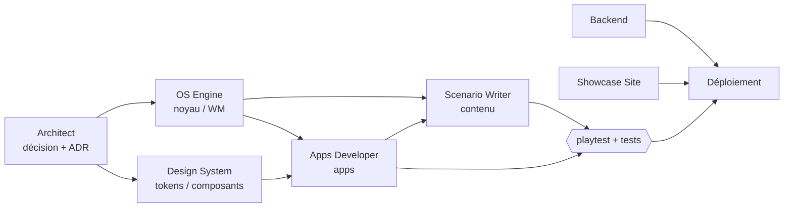

# Kernel_Panic — Agents

Le projet est développé par une équipe d'agents spécialisés, chacun avec un périmètre, des documents de référence et une définition de « fini ». Les définitions exécutables sont dans `.claude/agents/*.md` ; les procédures répétables dans `.claude/skills/*/SKILL.md`.

## Équipe

| Agent | Fichier | Modèle · effort | Périmètre |
|---|---|---|---|
| **Architect** | `.claude/agents/architect.md` | Opus · max | Stack, frontières kernel/desktop/contenu, formats versionnés, ADR (`ARCHITECTURE.md §11`), arbitrage des dépendances |
| **OS Engine** | `.claude/agents/os-engine.md` | Opus · max | `packages/kernel` (VFS, users, shell, commandes, runtime), window manager, pont réactif, line editor du terminal |
| **Apps Developer** | `.claude/agents/apps-developer.md` | Opus · medium | Apps du bureau : Fichiers, Terminal (UI), Notes, Mail, Images, Logs, Dossier, futures apps |
| **Scenario Writer** | `.claude/agents/scenario-writer.md` | Opus · max | `scenarios/**` : narration, chronologie, disque virtuel, indices, objectifs, `SOLUTION.md`, tests de playthrough |
| **Design System** | `.claude/agents/design-system.md` | Opus · max | NOCTIS : tokens, typo, composants, motion, icônes, accessibilité, cohérence jeu/site |
| **Backend** | `.claude/agents/backend.md` | Opus · medium | Sauvegardes, `apps/server` (Axum + SQLite), validation serveur, leaderboard, serveurs distants, déploiement |
| **Showcase Site** | `.claude/agents/showcase-site.md` | Opus · medium | `apps/site` (Astro) : pages, SEO, performance, devlog |
| **Scaffolder** | `.claude/agents/scaffolder.md` | Haiku | Boilerplate, configs, dossiers, mise en forme Markdown, corrections mécaniques |

Règle de répartition des modèles : **Opus max** pour ce qui est structurant ou narratif (architecture, moteur OS, design system, scénario principal) ; **Opus medium** pour le développement applicatif, le backend et le site ; **Haiku** pour le répétitif.

## Skills

| Skill | Usage |
|---|---|
| `new-app` | Ajouter une application au bureau (composant, manifeste, événements, vérifications) |
| `new-scenario` | Créer un scénario (chronologie → squelette → disque → objectifs → test de playthrough) |
| `new-command` | Ajouter une commande : outil déclaratif de scénario (YAML) ou commande système (TS) |
| `playtest` | Jouer dans Chromium headless, capturer chaque écran, remonter les erreurs console |

## Flux de travail type



1. Une demande structurante passe d'abord par **Architect** (décision consignée).
2. Les agents d'implémentation travaillent dans leur périmètre et livrent avec leurs vérifications.
3. Toute modification visible passe par le skill **playtest** ; tout changement de noyau ou de scénario garde `pnpm test` vert (le test de playthrough de Ghost Shift est la non-régression de référence).

## Conventions communes

- Langue : docs et UI en français ; code, commentaires et artefacts machine (logs, man) en anglais.
- Versions épinglées (pas de `^`) ; toute nouvelle dépendance validée par Architect.
- Commandes de vérification :

```bash
pnpm install
pnpm scenarios:check     # valide tous les scénarios
pnpm test                # kernel + playthrough des scénarios + serveur
pnpm check               # typecheck (kernel, scenario-kit, game)
pnpm build               # jeu + site
```
