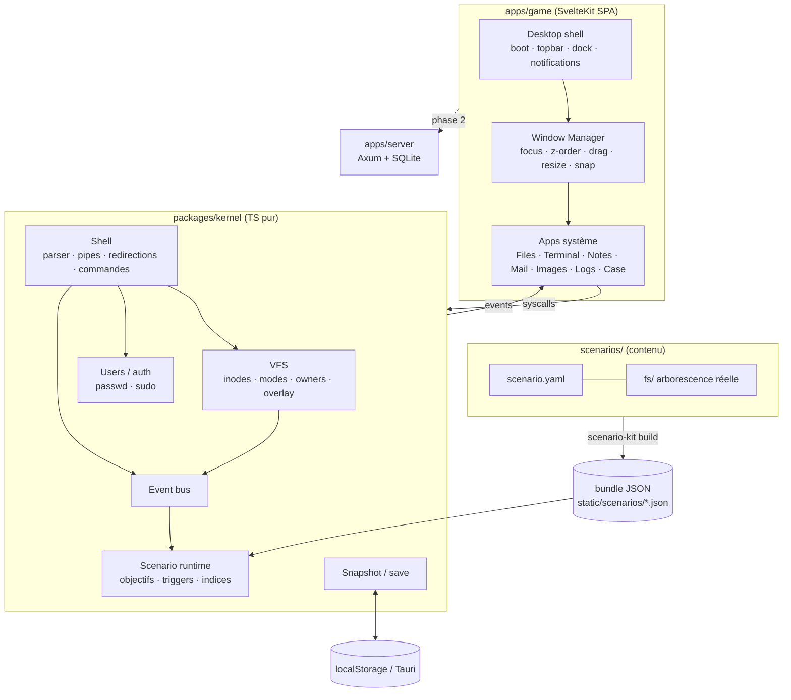

# Kernel_Panic — Architecture

> Document de référence. Toute décision structurante passe par l'agent **Architect** et est consignée ici (section *Journal des décisions*).

## 1. Analyse des références

| Projet | Ce qu'on retient | Ce qu'on évite |
|---|---|---|
| **OS.js** | Séparation nette *kernel / services / apps*, manifestes d'apps, associations MIME → app, VFS par « mountpoints ». | Lourdeur (serveur Node obligatoire, packages npm par app), look « Windows 98 web ». |
| **Aurora-OS.js** | Le jeu *est* l'OS : VFS crédible, terminal comme vecteur principal, permissions et utilisateurs Unix, progression par découverte. | Couplage fort UI ↔ logique de jeu, contenu codé en dur dans les composants. |
| **hackmud** | Le terminal comme interface de pouvoir, la sensation de « vraie » syntaxe, la narration par artefacts (logs, scripts, fragments). | Courbe d'apprentissage brutale et esthétique ASCII brute. |

**Synthèse** : un *noyau* TypeScript pur (testable sans DOM) qui simule un Unix crédible, une *couche bureau* qui n'est qu'un client de ce noyau, et des *scénarios* qui sont **du contenu** (fichiers réels + manifeste YAML), jamais du code applicatif.

## 2. Stack finale (décision argumentée)

| Couche | Choix | Statut vs recommandation | Justification |
|---|---|---|---|
| Jeu (UI) | **SvelteKit 2 + Svelte 5 (runes)**, `adapter-static`, mode SPA | ✅ Validé | Pas de virtual DOM → bundle minuscule et réactivité fine, idéal pour des dizaines de fenêtres. Les runes (`$state` dans des classes) donnent un store de window manager simple. `adapter-static` produit un dossier statique servi tel quel par nginx **et** embarqué par Tauri. Le routage SvelteKit sert uniquement à `/` (OS) — l'OS gère lui-même son « routage » interne. |
| Noyau OS | **TypeScript pur** (`packages/kernel`) | ➕ Ajout | VFS, permissions, utilisateurs, shell, bus d'événements, runtime de scénario. Zéro dépendance DOM → tests Vitest rapides, réutilisable côté serveur (validation des flags) et dans un futur mode CLI. |
| Terminal | **xterm.js 5** (`@xterm/xterm` + `addon-fit`) | ✅ Validé | Standard de fait (VS Code), rendu correct des séquences ANSI, sélection, copier-coller. xterm n'est qu'un *émulateur* : la ligne d'édition (curseur, historique, complétion Tab) est gérée par notre `LineEditor`, le shell par le noyau. |
| Contenu | **YAML + arborescence de fichiers réels**, compilé en JSON (`packages/scenario-kit`) | ➕ Ajout | Un scénariste écrit des fichiers `.eml`, `.log`, `.md`, `.svg` dans un dossier `fs/` qui *est* le disque virtuel. Le compilateur valide (schéma, références, hash des réponses) et produit un bundle JSON chargé à la demande. |
| Persistance MVP | **Local-first** : `localStorage` (web) / même API dans la WebView Tauri | ➕ Ajout | Le premier scénario est solo : aucune raison d'imposer un serveur. Sauvegarde = *diff* du VFS + état du scénario + historique shell. |
| Backend (phase 2) | **Axum (Rust) + SQLite (sqlx)** | ✅ Axum retenu, ❌ PocketBase écarté | Voir §2.1. |
| Desktop | **Tauri 2** | ✅ Validé | ~5–10 Mo vs ~150 Mo Electron, WebView système, Rust partagé avec le backend. Le front est le même build statique. |
| Site vitrine | **Astro 5** (statique) | ✅ Astro retenu, ❌ Next.js écarté | Zéro JS par défaut, SEO parfait, Markdown natif pour devlog/changelog, peut importer des composants Svelte si besoin (îlots). Next.js impose un runtime Node pour tirer parti de ses atouts — inutile ici. |
| Monorepo | **pnpm workspaces** | ➕ | Simple, rapide, liens locaux entre `kernel` et `game`. Turborepo ajoutable plus tard si les builds ralentissent. |
| Déploiement | **Docker (nginx) sur Coolify**, Cloudflare en proxy | ✅ | Voir `DEPLOYMENT.md`. |

### 2.1 PocketBase vs Axum

PocketBase est imbattable pour « auth + CRUD + admin UI » en 10 minutes. Mais nos besoins serveur sont **du gameplay**, pas du CRUD :

1. **Validation des flags côté serveur** (anti-triche leaderboard) → logique métier spécifique.
2. **« Serveurs distants » hackables** : un `ssh` dans le jeu ouvre une session sur une machine simulée *côté serveur* (état persistant, multi-joueurs plus tard). C'est un protocole (WebSocket) avec une machine à états, pas une table.
3. **Réutilisation du code Rust** avec Tauri (types partagés, éventuellement le même crate de simulation embarqué en mode offline).

Axum + SQLite donne un binaire unique de ~10 Mo, déployable dans le même `docker-compose`. Coût : on écrit l'auth nous-mêmes (sessions par lien magique / token anonyme ; pas de mot de passe à stocker au début).

**Le MVP n'en dépend pas** : le squelette `apps/server` existe pour fixer le contrat d'API, il est activé en phase 2.

## 3. Vue d'ensemble



**Règle d'or** : une app ne touche *jamais* directement l'état du scénario. Elle appelle le noyau (`kernel.fs.read`, `kernel.exec`, `kernel.emit('mail.open')`) ; le runtime de scénario observe le bus et fait progresser les objectifs. Conséquence : ce qu'on peut faire dans l'UI, on peut le faire au terminal, et inversement — c'est la même machine.

## 4. Le noyau (`packages/kernel`)

```
packages/kernel/src/
├─ index.ts            # API publique : createKernel()
├─ kernel.ts           # Kernel = vfs + users + shell + bus + scenario
├─ events.ts           # EventBus typé (KernelEvents)
├─ vfs/
│  ├─ vfs.ts           # arbre d'inodes, résolution de chemins, permissions
│  └─ path.ts          # normalize/join/dirname/basename (POSIX)
├─ users.ts            # comptes, groupes, vérification mot de passe (sha256)
├─ shell/
│  ├─ parser.ts        # tokens → pipeline (quotes, $VAR, ~, glob, | > >> && || ;)
│  ├─ shell.ts         # exécution, env, cwd, historique, sudo
│  ├─ commands/        # 1 fichier par famille de commandes
│  └─ scripted.ts      # commandes déclarées par un scénario (YAML)
├─ scenario/
│  ├─ types.ts         # ScenarioBundle (format compilé)
│  └─ runtime.ts       # objectifs, triggers, réponses hashées, indices
└─ util/ (hash, mail parser, text helpers)
```

### 4.1 VFS

- **Inode** : `{ type: 'file'|'dir'|'symlink', name, mode (octal), owner, group, mtime, content?, children?, target?, meta? }`.
- **Permissions Unix réelles** : `r/w/x` owner/group/other ; `x` sur un dossier requis pour le traverser ; root passe outre. Les erreurs sont les vraies (`Permission denied`, `No such file or directory`, `Not a directory`, `Is a directory`).
- **Fichiers cachés** : convention `.` ; `ls` les masque, `ls -a` les montre, l'explorateur a un toggle.
- **Contenu** : texte UTF-8 ; les binaires (images raster) sont des `data:` URL ; les SVG sont du texte (donc `cat`/`strings` révèlent leurs métadonnées — un vrai vecteur d'indice).
- **Overlay** : l'image de base vient du bundle (immuable) ; les écritures du joueur sont journalisées dans un *diff* (`writes`, `deletes`, `chmods`) → la sauvegarde ne contient que ce diff.
- **Événements** : `fs.read`, `fs.write`, `fs.list` (avec le chemin et l'utilisateur) → triggers de scénario.

### 4.2 Shell

- Parser maison (≈ 200 lignes) : guillemets simples/doubles, échappements, `$VAR` / `${VAR}` / `$?`, `~`, globbing `*`/`?` sur le VFS, pipelines `|`, redirections `>`, `>>`, `<`, `2>/dev/null`, enchaînements `;`, `&&`, `||`.
- Une commande = `(ctx: CommandContext) => number | Promise<number>` ; `ctx` fournit `args`, `stdin`, `out()`, `err()`, `env`, `cwd`, `user`, `kernel`. Les sorties sont des chaînes (avec ANSI) → testables.
- Commandes fournies (MVP) : `ls cd pwd cat head tail grep find tree file stat wc sort uniq cut echo printf touch mkdir rm mv cp chmod base64 xxd strings sha256sum md5sum whoami id hostname uname date uptime ps env export history clear help man sudo su exit open which crontab ifconfig ip netstat ping curl*`.
- `sudo` : vérifie le mot de passe du compte courant contre le hash du scénario, accorde un ticket de 5 minutes de jeu. Un succès émet `auth.sudo`.
- **Commandes scénarisées** : un scénario peut déclarer des outils propres à l'univers (`lumenctl`, `vpn`, …) en YAML, avec des règles regex → sortie + effets (`emit`, `write`, `requireRoot`). Pas de code arbitraire dans le contenu.

### 4.3 Runtime de scénario

- Charge un `ScenarioBundle` JSON, monte le VFS, crée les utilisateurs, enregistre les commandes scénarisées.
- **Objectifs** : liste ordonnée, chacun avec `trigger` (événement + filtres) **ou** `answer` (réponse saisie dans l'app *Case*, comparée par SHA-256 après normalisation), `requires` (dépendances), `hints` (paliers).
- **Effets à la complétion** : livrer un mail (fichier `.eml` déposé dans la Maildir → notification), débloquer un fichier, afficher une notification, terminer le scénario.
- Les réponses ne sont **jamais** en clair dans le bundle.

## 5. Le bureau (`apps/game`)

```
apps/game/src/
├─ routes/+page.svelte          # Boot → Desktop
├─ lib/
│  ├─ os/
│  │  ├─ kernel.svelte.ts       # instance unique du noyau + pont réactif ($state)
│  │  ├─ wm.svelte.ts           # WindowManager (runes)
│  │  ├─ apps.ts                # registre des apps (manifestes)
│  │  ├─ notify.svelte.ts       # toasts
│  │  └─ save.ts                # autosave localStorage
│  ├─ desktop/                  # Boot, Desktop, TopBar, Dock, Window, Toasts
│  ├─ apps/<id>/<Id>.svelte     # une app = un composant + un manifeste
│  └─ styles/tokens.css         # design tokens (DESIGN_SYSTEM.md)
└─ src-tauri/                   # coquille desktop
```

### 5.1 Système d'applications

Une app est déclarée par un **manifeste** :

```ts
export interface AppManifest {
  id: string;                 // 'mail'
  title: string;              // 'Mail'
  icon: string;               // nom d'icône (sprite SVG interne)
  component: Component<AppProps>;
  opens?: { ext?: string[]; mime?: string[] };  // associations fichiers
  singleton?: boolean;        // une seule instance (Mail, Case)
  defaultSize?: { w: number; h: number };
  dock?: boolean;             // épinglée dans le dock
}
export interface AppProps { win: WindowState; args: Record<string, unknown> }
```

- **Lancement** : `wm.open(appId, args)` depuis le dock, l'explorateur (double-clic → résolution par extension), ou le terminal (`open fichier` émet `app.open` sur le bus ; le bureau l'écoute).
- **Accès au système** : uniquement via `os.kernel` (lecture/écriture VFS **avec l'utilisateur de session**, donc mêmes permissions que le terminal).
- **Ajouter une app** = créer `lib/apps/<id>/`, exporter un manifeste, l'ajouter au registre. Skill : `.claude/skills/new-app`.

| App | Rôle dans l'enquête | Ouvre |
|---|---|---|
| **Files** | Explorer l'arborescence, révéler les fichiers cachés, voir propriétaire/permissions. | dossiers |
| **Terminal** | Le scalpel : `grep`, `find`, `base64 -d`, `sudo`, commandes scénarisées. | — |
| **Notes** | Lire/éditer du texte ; le joueur peut prendre ses propres notes (`~/notes-enquete.md`). | `.txt .md .conf .sh .json .yaml` … |
| **Mail** | Client Maildir : lit les `.eml` réels, affiche les en-têtes complets (indices de spoofing). | `.eml` |
| **Images** | Visionneuse (zoom, panneau métadonnées/EXIF). | `.svg .png .jpg` |
| **Logs** | Visionneuse de journaux : coloration par niveau, filtre texte/regex, saut à l'horodatage. | `.log`, `/var/log/*` |
| **Case** | Dossier d'enquête : objectifs, réponses, indices, **pièces à conviction** (avec lien vers leur source) et **décisions** finales. | — |
| **Paramètres** | Fond d'écran, son, ne pas déranger, lisibilité, « À propos » (machine, noyau, IP, uptime). | — |
| **Propriétés** | Type (`file`), taille, dates, propriétaire, **permissions rwx modifiables** (règle réelle : seul le propriétaire, sinon `sudo chmod`). | tout chemin |

### 5.1b Le bureau

Le bureau se comporte comme un environnement Linux réel, et tout passe par le noyau avec les droits de la session :

- **Icônes** = contenu de `~/Desktop` (créé s'il manque) + Dossier personnel, Corbeille, Dossier d'enquête. Les lanceurs sont de vrais fichiers freedesktop `.desktop` (`Exec=<app> [chemin]`, `Icon=`). Positions sur grille sauvegardées avec la partie.
- **Interactions** : double-clic, sélection (clic, Ctrl, lasso), glisser-déposer (HTML5, partagé avec l'app Fichiers : déplacer, Ctrl = copier, vers un dossier, vers la Corbeille), F2, Suppr, Ctrl+A/C/X/V, Entrée.
- **Menus contextuels** construits par `lib/os/filemenu.ts` (mêmes menus sur le bureau et dans Fichiers) : ouvrir, ouvrir avec, terminal ici, couper/copier/coller, renommer, corbeille, propriétés ; fond : nouveau dossier/document, coller, réorganiser, fichiers cachés, fond d'écran.
- **Corbeille** au format freedesktop (`~/.local/share/Trash/{files,info}` + `.trashinfo` avec `Path=` et `DeletionDate=`), donc restaurable — et visible au terminal.
- **Barre des tâches** : lanceur avec recherche, apps épinglées, une entrée par fenêtre, zone de notification (objectifs, centre de notifications avec « ne pas déranger », son, réseau, calendrier de la machine, afficher le bureau).
- Opérations fichiers : `lib/os/fileops.svelte.ts` ; état du bureau : `lib/os/desktop.svelte.ts` ; préférences par navigateur : `lib/os/settings.svelte.ts`.

### 5.2 Window Manager

État par fenêtre : `{ id, appId, title, x, y, w, h, z, minimized, maximized, snap, args }`. Focus = z max, déplacement par pointer events (capture), redimensionnement par 8 poignées, double-clic sur la barre = maximiser, **ancrage** : bord gauche/droit = moitié d'écran, haut = plein écran (aperçu pendant le glisser ; traîner une fenêtre ancrée la décroche). Sélecteur de fenêtres façon Alt+Tab : maintenir `Ctrl` ou `Alt` et appuyer sur `` ` ``. Raccourcis : `Ctrl+Alt+T` terminal, `Ctrl+Alt+←/→/↑` ancrer/agrandir, `Ctrl+Alt+D` afficher le bureau, `Ctrl+Alt+W` fermer, `Ctrl+Alt+H` aide. Les raccourcis du bureau sont écoutés en phase de capture pour passer avant les apps (xterm).

## 6. Format de scénario (résumé)

Voir `SCENARIO_ENGINE.md`. Un scénario = un dossier :

```
scenarios/01-ghost-shift/
├─ scenario.yaml     # métadonnées, machine, utilisateurs, objectifs, commandes, triggers
└─ fs/               # racine du disque virtuel (copié tel quel)
   ├─ home/elias/...
   ├─ var/log/...
   └─ etc/...
```

## 7. Persistance & sauvegarde

- `SaveGame = { version, scenarioId, vfsDiff, scenarioState, shell: { history, cwd }, windows, playtime }`.
- Autosave toutes les 15 s et à chaque objectif. Une clé par scénario : `kp.save.<scenarioId>`.
- Phase 2 : synchronisation optionnelle avec `apps/server` (`PUT /api/saves/:scenario`).

## 8. Sécurité

- **Aucune exécution réelle** : le shell n'interprète que nos commandes TS ; les commandes scénarisées sont déclaratives (regex → texte/effets).
- Pas d'`eval`, pas de `{@html}` sur du contenu non échappé (le Markdown des notes est rendu en texte ; les SVG sont affichés via ``, donc sans script).
- `curl`/`ping` sont simulés ; aucune requête réseau sortante.
- CSP stricte en prod (voir `DEPLOYMENT.md`), Tauri avec allowlist vide (aucune commande native exposée au MVP).

## 9. Performance

- Bundle de jeu cible < 300 Ko gzip (xterm ≈ 90 Ko inclus), scénarios chargés à la demande.
- Les apps sont importées dynamiquement (`import()`) au premier lancement.
- Animations CSS (`transform`/`opacity` uniquement), `prefers-reduced-motion` respecté.

## 10. Structure du dépôt

```
KernelPanic/
├─ apps/
│  ├─ game/            # SvelteKit SPA + src-tauri (desktop)
│  ├─ site/            # Astro — site vitrine
│  └─ server/          # Axum — phase 2 (squelette)
├─ packages/
│  ├─ kernel/          # noyau OS (TS pur, testé)
│  └─ scenario-kit/    # compilateur / validateur de scénarios (CLI)
├─ scenarios/          # contenu jouable
├─ docker/             # Dockerfile, nginx.conf, compose
├─ docs/               # docs complémentaires (roadmap…)
├─ .claude/agents/     # agents spécialisés
├─ .claude/skills/     # skills (procédures répétables)
└─ *.md                # ARCHITECTURE, DESIGN_SYSTEM, SCENARIO_ENGINE, AGENTS, DEPLOYMENT
```

## 11. Journal des décisions (ADR courts)

| # | Date | Décision | Raison |
|---|---|---|---|
| 001 | 2026-10-23 | SvelteKit SPA (`ssr = false`) | L'OS est une app 100 % client ; SSR inutile, simplifie Tauri. |
| 002 | 2026-10-23 | Noyau TS séparé du front | Testabilité, réutilisation serveur, contenu découplé. |
| 003 | 2026-10-23 | Contenu = fichiers réels + YAML | Ergonomie scénariste, diff Git lisibles, immersion (vrais `.eml`). |
| 004 | 2026-10-23 | Réponses hashées SHA-256 | Pas de spoil en lisant le bundle. |
| 005 | 2026-10-23 | Axum plutôt que PocketBase, différé | Besoins gameplay (validation, serveurs simulés) > CRUD. |
| 006 | 2026-10-23 | Astro pour la vitrine | SEO + zéro JS. |
| 008 | 2026-10-23 | Pièces à conviction, décisions conditionnées par les pièces, fins multiples (référence : *Orwell*) | Le joueur ne fait pas que trouver des réponses : il juge des faits parfois trompeurs et assume ce qu'il en fait. Tout est déclaratif dans le scénario, aucune logique spécifique dans l'UI. |
| 007 | 2026-10-23 | Un seul domaine `kernel.fs0ciety.org` (site `/`, jeu `/play/`, API `/api/`) | Le certificat Universal SSL de Cloudflare ne couvre pas les sous-domaines de 2ᵉ niveau (`play.kernel.fs0ciety.org`). |
