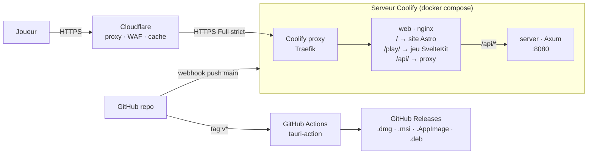

# Kernel_Panic — Déploiement

Web sur **Coolify** derrière **Cloudflare**, builds desktop via **Tauri** et GitHub Actions.

## 1. Vue d'ensemble



### Un seul hôte : `kernel.fs0ciety.org`

| Chemin | Contenu | Source |
|---|---|---|
| `/` | Site vitrine (Astro statique) | `apps/site/dist` |
| `/play/` | Le jeu (SPA SvelteKit, `KP_BASE=/play`) | `apps/game/build` |
| `/api/` | Backend Axum (phase 2 — saves, vérification) | service `server` |
| `/healthz` | Sonde de santé nginx | — |

**Pourquoi pas `play.kernel.fs0ciety.org` ?** Le certificat *Universal SSL* gratuit de Cloudflare couvre `fs0ciety.org` et `*.fs0ciety.org`, mais **pas** les sous-domaines de second niveau (`*.kernel.fs0ciety.org`). Il faudrait Advanced Certificate Manager (payant). Un seul hôte avec des chemins évite aussi le CORS et partage l'origine (cookies, `localStorage`).

## 2. Fichiers

| Fichier | Rôle |
|---|---|
| `docker/Dockerfile` | Image `web` : build pnpm (scénarios → jeu → site) puis nginx 1.27-alpine |
| `docker/nginx.conf` | Template nginx (envsubst) : routes, cache, gzip, proxy `/api/` |
| `docker/security-headers.conf` | En-têtes de sécurité (CSP, HSTS, …) inclus dans chaque `location` |
| `docker/docker-compose.yml` | Ressource Coolify : services `web` + `server` |
| `apps/server/Dockerfile` | Image `server` : Rust → debian-slim, utilisateur non-root |
| `.dockerignore` | Exclut `node_modules`, builds, `target`, `src-tauri` |
| `.github/workflows/ci.yml` | Lint/tests/build + `cargo test` + build de l'image |
| `.github/workflows/desktop.yml` | Builds Tauri multi-OS sur tag `v*` |

### Proxy `/api/` résilient

nginx résout l'upstream **à la requête** (`resolver` + variable `$kp_api`) : le conteneur `web` démarre même si `server` n'est pas déployé (les appels `/api/` renvoient alors 502, le jeu reste local-first). Le résolveur par défaut `127.0.0.11` est le DNS interne de Docker.

## 3. Variables d'environnement

| Variable | Service | Défaut | Rôle |
|---|---|---|---|
| `KP_BASE` | build du jeu | `''` | Chemin de base SvelteKit (`/play` pour le web, vide pour Tauri). Fixé dans le Dockerfile. |
| `KP_API_UPSTREAM` | web (runtime) | `server:8080` | Hôte:port de l'API pour le proxy nginx |
| `KP_RESOLVER` | web (runtime) | `127.0.0.11` | Résolveur DNS utilisé par nginx |
| `PORT` | server | `8080` | Port d'écoute Axum |
| `RUST_LOG` | server | `kp_server=info,tower_http=info` | Niveau de logs |
| `DATABASE_URL` | server (phase 2) | — | `sqlite:///data/kp.db` (volume persistant) |

Aucun secret n'est requis pour le MVP.

## 4. Cloudflare

> **État actuel (en place)** : zone `fs0ciety.org`, enregistrement `CNAME kernel → fs0ciety.org`, **proxied**, comme les autres apps de la zone. Mode SSL de la zone : **Full (strict)** (déjà réglé). *Always Use HTTPS* est désactivé au niveau de la zone ; la redirection HTTP→HTTPS est faite par Coolify (*Force HTTPS*). Les réglages ci-dessous (cache, Rocket Loader…) restent à appliquer ou à vérifier ; ils sont **zone-wide** et touchent donc toutes les apps de `fs0ciety.org`.

1. **DNS** : enregistrement `A kernel → <IP du serveur Coolify>` (ou `CNAME` vers l'hôte Coolify), **proxied** (nuage orange).
2. **SSL/TLS → Overview** : mode **Full (strict)**.
3. **Certificat d'origine**, au choix :
   - laisser Coolify/Traefik obtenir un certificat Let's Encrypt (le challenge HTTP-01 passe à travers le proxy Cloudflare) ;
   - ou créer un **Origin Certificate** Cloudflare (15 ans) et le charger dans Coolify (*Servers → Proxy → certificats personnalisés*).
4. **SSL/TLS → Edge Certificates** : *Always Use HTTPS* ✅, *Min TLS 1.2*, *Automatic HTTPS Rewrites* ✅. HSTS est déjà envoyé par nginx.
5. **Speed → Optimization** : Brotli ✅ ; **désactiver Rocket Loader** (casse le bootstrap SvelteKit) et Auto Minify (déjà minifié).
6. **Caching → Cache Rules** :

| Règle | Expression | Action |
|---|---|---|
| API jamais en cache | `starts_with(http.request.uri.path, "/api/")` | Bypass cache |
| Assets immuables | `starts_with(http.request.uri.path, "/play/_app/immutable/") or starts_with(http.request.uri.path, "/_astro/")` | Eligible, Edge TTL 1 an, respecter l'origine |
| Scénarios | `starts_with(http.request.uri.path, "/play/scenarios/")` | Respecter l'origine (`no-cache`) |

Le HTML est servi en `no-cache` par nginx : un déploiement est visible immédiatement, sans purge. En cas de doute : *Caching → Purge Everything*.

7. **Security** : WAF managé + rate limiting sur `/api/*` (ex. 60 req/min/IP) quand le backend sera actif.

## 5. Coolify — pas à pas

> **État actuel (en place)** : projet **Kernel_Panic**, application **kernel-panic-web** sur le serveur `localhost`, source GitHub App privée, branche `ccr-aadfddbd-8ps2l1` (à basculer sur `main` après fusion de la PR), *build pack* **Dockerfile** (`/docker/Dockerfile`, contexte `/`), port 80, domaine `https://kernel.fs0ciety.org`, healthcheck `/healthz`, *Force HTTPS* et *Automatic deployment* actifs. Le service `server` (Axum) n'est **pas** déployé au MVP : `/api/` répond 502, le jeu sauvegarde en local.
>
> Pour l'activer en phase 2 : soit passer l'app en *Docker Compose* (`/docker/docker-compose.yml`), soit déployer `apps/server/Dockerfile` comme seconde app sur le même réseau Docker, nommée `server` (ou régler `KP_API_UPSTREAM` sur son nom interne).

Procédure générique (référence) :

1. **Sources** : connecter le dépôt GitHub (GitHub App Coolify).
2. **New Resource → Docker Compose** → dépôt `fs0ciety7000/KernelPanic`, branche `main`, *Docker Compose Location* : `/docker/docker-compose.yml`.
3. **Domaines** : sur le service `web`, `https://kernel.fs0ciety.org` (port 80). Ne pas exposer `server` (il n'est joignable que via `/api/`).
4. **Environment Variables** : rien d'obligatoire ; surcharger `RUST_LOG` si besoin.
5. **Health checks** : définis dans le compose (`/healthz` pour web, `/api/health` pour server) — Coolify les affiche et ne bascule le trafic qu'une fois `healthy`.
6. **Persistent storage** (phase 2) : volume `/data` sur `server` pour SQLite.
7. **Auto-deploy** : activer *Automatic deployment* (webhook GitHub) sur `main`. Option recommandée : déclencher seulement si la CI est verte (*Webhooks → Deploy on successful CI* ou déploiement manuel depuis l'action).
8. Premier déploiement : *Deploy*, vérifier `https://kernel.fs0ciety.org/healthz`, `/`, `/play/`.

### Build local de l'image

Derrière un proxy TLS d'entreprise (ou dans un environnement cloud avec proxy), le build échoue sur `corepack`/`pnpm` faute de certificat : construire avec une copie locale du Dockerfile qui ajoute le CA (`COPY` du bundle + `NODE_EXTRA_CA_CERTS`) et les `--build-arg HTTPS_PROXY…`. Ne pas committer cette variante.

```bash
docker build -f docker/Dockerfile -t kp-web .
docker build -t kp-server apps/server
docker compose -f docker/docker-compose.yml up --build   # puis http://localhost via un port mappé temporaire
```

## 6. Rollback

1. **Coolify** : *Deployments* → choisir le déploiement précédent → **Redeploy** (l'image précédente est réutilisée si encore présente).
2. Sinon : `git revert <commit>` sur `main` → le webhook redéploie.
3. Cloudflare : *Purge Everything* si un HTML problématique a été mis en cache par erreur.
4. Les sauvegardes des joueurs sont dans leur `localStorage` (MVP) : un rollback n'en perd aucune. Le format de save est versionné (`SaveGame.version`) — toute migration doit rester rétro-compatible d'une version.

## 7. Desktop (Tauri 2)

Le jeu desktop embarque le **même build statique**, avec `KP_BASE` vide (servi à la racine de l'app).

### Prérequis

| OS | Prérequis |
|---|---|
| Tous | Node 22, pnpm 10, Rust stable (`rustup`) |
| macOS | Xcode Command Line Tools (`xcode-select --install`) |
| Windows | Microsoft C++ Build Tools, WebView2 (inclus dans Windows 10/11 récents) |
| Linux (Debian/Ubuntu) | `sudo apt install libwebkit2gtk-4.1-dev libappindicator3-dev librsvg2-dev patchelf build-essential` |

### Commandes

```bash
pnpm install
pnpm scenarios
pnpm tauri dev      # fenêtre desktop avec rechargement à chaud
pnpm tauri build    # binaires dans apps/game/src-tauri/target/release/bundle/
```

### CI de release

`.github/workflows/desktop.yml` se déclenche sur un tag `v*` (ou manuellement) et construit via `tauri-apps/tauri-action` :

| Runner | Artefacts |
|---|---|
| `macos-latest` (aarch64 + x86_64) | `.dmg`, `.app` |
| `windows-latest` | `.msi`, `.exe` (NSIS) |
| `ubuntu-22.04` | `.AppImage`, `.deb` |

Les binaires sont attachés à une **release brouillon** GitHub, publiée à la main après vérification.

```bash
git tag v0.1.0 && git push origin v0.1.0
```

### Signature

- **macOS** : sans signature, Gatekeeper bloque l'app. Avec un compte Apple Developer, renseigner les secrets `APPLE_CERTIFICATE` (p12 en base64), `APPLE_CERTIFICATE_PASSWORD`, `APPLE_SIGNING_IDENTITY`, `APPLE_ID`, `APPLE_PASSWORD` (mot de passe d'application), `APPLE_TEAM_ID` : tauri-action signe et **notarise** automatiquement.
- **Windows** : sans signature, SmartScreen affiche un avertissement. Options : certificat OV/EV (`certificateThumbprint` dans `tauri.conf.json`) ou **Azure Trusted Signing** (moins cher, compatible tauri via `signCommand`).
- **Linux** : pas de signature requise ; on peut signer l'AppImage (GPG) plus tard.

### Mises à jour automatiques (phase 2)

Plugin `tauri-plugin-updater` : clé de signature des mises à jour (`TAURI_SIGNING_PRIVATE_KEY` en secret CI), manifeste `latest.json` publié dans la release GitHub ; l'app vérifie au démarrage.

## 8. Checklist de mise en production

- [ ] CI verte sur `main` (tests noyau, validation scénarios, builds)
- [ ] `https://kernel.fs0ciety.org/healthz` → `ok`
- [ ] `/play/` charge, le scénario démarre, une sauvegarde survit à un rechargement
- [ ] En-têtes : `curl -sI https://kernel.fs0ciety.org/play/ | grep -i content-security`
- [ ] Assets `/play/_app/immutable/*` : `cache-control: public, max-age=31536000, immutable`
- [ ] `/api/health` → `{"status":"ok"}` (si `server` déployé)
