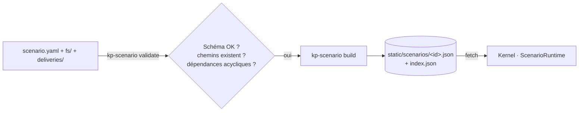

# Kernel_Panic — Scenario Engine

Un scénario est **du contenu**, pas du code. Il décrit une machine (disque, comptes, processus, réseau), des outils propres à son univers, et une suite d'objectifs que le runtime valide en observant ce que fait le joueur.

## 1. Anatomie d'un scénario

```
scenarios/<NN-slug>/
├─ scenario.yaml        # manifeste (ce document)
├─ fs/                  # racine du disque virtuel — copié tel quel dans le VFS
│  ├─ etc/…
│  ├─ home/<user>/…
│  └─ var/log/…
└─ deliveries/          # mails livrés en cours de partie (.eml), hors disque au départ
```

Pipeline :



Le compilateur (`packages/scenario-kit`) :
- lit récursivement `fs/` (texte → UTF-8 ; binaires → `data:` URL base64) ;
- applique la propriété par défaut (`/home/<u>/**` → `<u>:<u>`, ailleurs `root:root`), les modes par défaut (fichiers `0644`, dossiers `0755`, homes `0750`), puis les surcharges `permissions:` ;
- **hache** mots de passe et réponses (`sha256("<scenarioId>:" + valeur normalisée)`), pour qu'aucun spoil ne soit lisible dans le bundle ;
- valide les références (chemins des triggers, livraisons, `requires`).

```bash
pnpm scenarios          # build de tous les scénarios vers apps/game/static/scenarios
pnpm scenarios:check    # validation seule (CI)
```

## 2. `scenario.yaml` — référence

```yaml
id: ghost-shift                 # unique, kebab-case — sert de sel aux hash
version: 1
title: Ghost Shift
subtitle: Une poussée de firmware que personne n'a demandée.
summary: >                      # affiché dans le menu de sélection
  …
difficulty: beginner            # beginner | intermediate | advanced
estimatedMinutes: 35
locale: fr

machine:
  hostname: ws-varga
  domain: lumengrid.local
  os: LumenOS 22.04.4 LTS
  kernel: 6.8.0-41-lumen
  ip: 10.20.4.17
  clock: 2026-04-17T08:12:00+02:00   # heure de jeu au démarrage (avance en temps réel)

session:
  user: elias                   # utilisateur de la session graphique / du terminal
  cwd: /home/elias
  email: elias@lumengrid.fr     # adresse affichée par l'app Mail (défaut : user@domaine)
  autostart:                    # apps ouvertes au démarrage
    - { app: mail }

users:
  - { name: root,  uid: 0,    home: /root,        shell: /bin/bash }   # sans password → verrouillé
  - { name: elias, uid: 1000, home: /home/elias,  shell: /bin/bash, groups: [sudo, lumen-ops], password: "…" }

permissions:                    # surcharges (owner, group, mode octal en chaîne)
  - { path: /etc/lumen/override.key, owner: root, group: root, mode: "0600" }

processes:                      # pour ps / top
  - { pid: 1, user: root, cmd: /sbin/init }

network:                        # pour ifconfig / ip / netstat / ping / curl
  interfaces: [ { name: eth0, ip: 10.20.4.17, mac: "…" } ]
  connections: [ { proto: tcp, local: "10.20.4.17:22", remote: "…", state: ESTABLISHED, program: sshd } ]
  hosts: { "drop.k4de.net": { reachable: false } }

commands:                       # outils propres à l'univers (voir §4)
  lumenctl: { … }

objectives:                     # voir §3
  - …

evidence:                       # pièces à conviction, voir §3.3
  - …

endings:                        # fins multiples, voir §3.4
  - …

intro:  { title: …, lines: [ … ] }   # écran de briefing après le boot
outro:  { title: …, text: … }        # écran de fin
```

## 3. Objectifs

```yaml
- id: attacker-ip
  title: Identifier l'origine de l'intrusion
  description: D'où l'attaquant s'est-il connecté ?
  requires: [briefing]          # visible et validable seulement après ces objectifs
  optional: false               # true = bonus, n'empêche pas la fin
  # Validation : un trigger OU une réponse (ou les deux : `any`)
  answer:
    label: Adresse IP source
    placeholder: ex. 203.0.113.10
    accept: ["185.220.101.47"]  # en clair dans la source, hachées dans le bundle
    normalize: [trim, lower, nospace]   # défaut : [trim, lower]
  hints:                        # révélés un par un dans l'app Case (coût : -score)
    - Les en-têtes d'un mail racontent tout son trajet.
    - Cherche « Received: » ou « X-Originating-IP » dans le mail suspect — et recoupe avec /var/log/auth.log.
  onComplete:                   # effets
    - { deliver: 02-kessler-ip.eml }          # dépose deliveries/02-… dans ~/Maildir/new
    - { notify: { title: "…", body: "…" } }
```

### 3.1 Triggers

Un trigger écoute le bus d'événements du noyau.

```yaml
trigger:
  event: fs.read                     # type d'événement
  where: { path: /home/elias/.cache/.sync/sync.sh }   # égalité stricte
  regex: { line: "^crontab\\s+-l" }  # expressions régulières sur des champs texte
# ou plusieurs :
trigger:
  any:
    - { event: fs.read, where: { path: … } }
    - { event: cmd.exec, regex: { line: "crontab\\s+-l" } }
```

| Événement | Charge utile | Émis par |
|---|---|---|
| `fs.read` | `path, user` | toute lecture de contenu (cat, Notes, Images, Mail…) |
| `fs.write` | `path, user` | écriture, `touch`, redirection `>` |
| `fs.list` | `path, user` | `ls`, explorateur |
| `cmd.exec` | `name, argv, line, exit, user` | chaque commande du shell |
| `auth.sudo` | `user, ok` | `sudo` (mot de passe correct ou non) |
| `auth.su` | `user, target, ok` | `su` |
| `mail.open` | `path, messageId, subject, from` | app Mail |
| `image.open` | `path` | app Images |
| `app.open` | `appId, path?` | lancement d'app |
| `scenario.flag` | `id` | commandes scénarisées (`emit`) |
| `objective.complete` | `id` | runtime (chaînage) |
| `evidence.found` | `id, title` | runtime (pièce découverte) |
| `choice.made` | `objective, option` | runtime (décision prise) |

### 3.2 Effets `onComplete`

| Effet | Exemple | Résultat |
|---|---|---|
| `deliver` | `{ deliver: 03-final.eml }` | nouveau mail + notification « Nouveau message » |
| `notify` | `{ notify: { title, body } }` | toast narratif |
| `write` | `{ write: { path, content, mode? } }` | fichier créé/remplacé (en root) |
| `flag` | `{ flag: alarm-raised }` | émet `scenario.flag` (chaînage) |
| `end` | `{ end: true }` | écran de fin (score, temps, indices utilisés) |

### 3.3 Pièces à conviction

Inspiré d'*Orwell* : l'enquête ne se résume pas à des réponses justes, elle accumule des **faits sourcés** que le joueur pourra (ou non) utiliser. Une pièce est découverte automatiquement quand son trigger se déclenche, une seule fois, à n'importe quel moment de la partie, et s'affiche dans l'onglet « Pièces » du Dossier avec un lien vers sa source.

```yaml
evidence:
  - id: exec-trace
    title: Trace d'exécution auditd
    summary: "06/05 23:10:02 — auid=1001 (mlefort) lance python3 ~/.local/share/.cache/sync.py"
    source: /var/log/audit/audit.log      # rouvrable depuis le Dossier
    tag: témoin                           # badge libre : vecteur, témoin, contradiction, contexte…
    trigger: { event: cmd.exec, regex: { line: "audit\\.log" } }
```

Une pièce peut être **trompeuse** : le moteur ne le sait pas, c'est au joueur d'en juger (et au scénario de punir une conclusion hâtive par la fin qu'il obtient).

### 3.4 Choix et fins multiples

Un objectif peut être une **décision** (`choice`). Chaque option peut exiger des pièces : on ne peut accuser, dénoncer ou protéger qu'avec ce qu'on a trouvé. Au moins une option doit rester toujours disponible. Le choix est définitif.

```yaml
- id: verdict
  title: Rendre votre rapport
  requires: [qui]
  choice:
    prompt: Que transmettez-vous à votre client ?
    options:
      - id: name-source
        label: Donner le nom de la source
        detail: Le contrat est rempli.
        requiresEvidence: [exec-trace]
        flags: [source-exposed]           # + flag automatique `choice:verdict:name-source`
        onSelect: [{ deliver: 06-client-merci.eml }]
      - id: inconclusive
        label: Conclure à une enquête non concluante
  onComplete: [{ end: true }]

endings:                                   # évaluées dans l'ordre à l'effet `end` ; la 1re qui correspond gagne
  - id: price-of-silence
    title: Le prix du silence
    text: …
    flags: [source-exposed]
    notFlags: []
  - id: fog                                # sans condition = fin par défaut
    title: Brouillard
    text: …
```

L'écran de fin affiche la fin obtenue (« Fin 2/4 ») ; `outro` reste le repli si aucune fin ne correspond.

## 4. Commandes scénarisées

Déclaratives : la ligne d'arguments est comparée aux règles dans l'ordre ; la première qui matche gagne.

```yaml
commands:
  lumenctl:
    path: /usr/local/bin/lumenctl      # pour `which` et `ls /usr/local/bin`
    summary: Lumen Grid OT control utility
    group: lumen-ops                   # sinon « permission denied »
    rules:
      - match: "^status$"
        output: |
          JOB        TARGET          STATE    AT
          JOB-0417   substation-*    QUEUED   09:00
      - match: "^abort JOB-0417 --token OVR-7Q2K-VX91$"
        requireRoot: true
        output: "[ok] JOB-0417 aborted."
        emit: job-aborted              # → scenario.flag {id: job-aborted}
        once: true                     # n'émet qu'une fois
      - match: "^abort"
        exit: 1
        output: "lumenctl: abort requires a valid operator override token"
    fallback: |                        # aucun match
      usage: lumenctl <status|jobs|abort> [options]
```

Champs d’une règle : `ifFlag` / `unlessFlag` (conditions sur un flag déjà levé), `write` peut être une liste (ex. `unzip` qui extrait plusieurs fichiers ; chemins avec `{{cwd}}`), `match` (regex sur les arguments joints par des espaces), `output` (texte, ANSI autorisé via `\e[…m`), `exit` (défaut 0), `requireRoot`, `emit`, `once`, `write` (même forme que l'effet).

Variables substituées dans `output` : `{{user}}`, `{{hostname}}`, `{{date}}`, `{{cwd}}`.

## 5. Mails

Les mails sont de vrais fichiers RFC 822 (`.eml`) dans une **Maildir** :

```
/home/<user>/Maildir/new/   # non lus
/home/<user>/Maildir/cur/   # lus (l'app Mail y déplace le fichier à l'ouverture)
/home/<user>/Maildir/.Sent/cur/
```

En-têtes reconnus pour l'affichage : `From`, `To`, `Cc`, `Subject`, `Date`, `Message-ID` ; **tous** les en-têtes sont visibles via « Afficher la source » (et `cat`). C'est voulu : `Received`, `Return-Path`, `X-Originating-IP` sont des indices.

L'événement `mail.open` porte le `Message-ID` sans chevrons — c'est la clé à utiliser dans les triggers.

## 6. Images

`.svg` (texte : les balises `<metadata>`, `<title>`, `<desc>` sont lisibles au terminal **et** affichées par l'app Images dans le panneau « Métadonnées ») ou `.png/.jpg` (binaires). Pour des métadonnées sur un raster, ajouter un fichier sidecar `<image>.meta.yaml` (non monté) — phase 2.

Convention de métadonnées SVG reconnue par la visionneuse :

```xml
<metadata>
  <kp:exif xmlns:kp="https://kernel.fsociety.org/ns" Make="Fairphone" Model="FP5"
           DateTimeOriginal="2019-03-09 14:02:11" Description="…"/>
</metadata>
```

## 7. Règles d'écriture (checklist scénariste)

1. **Chaque objectif a au moins deux chemins** (ex. l'IP est dans les en-têtes du mail *et* dans `auth.log`).
2. **Bruit crédible** : ~60 % des fichiers ne servent pas l'intrigue mais rendent la machine vivante (planning d'astreinte, newsletter, photos).
3. **Chaque app de base sert au moins une fois** : Mail (en-têtes), Images (métadonnées), Logs (filtre), Notes (runbook), Files (fichiers cachés), Terminal (`base64 -d`, `sudo`, `strings`).
4. **Indices en 2–3 paliers** : orientation → méthode → quasi-solution.
5. **Cohérence temporelle** : tous les horodatages (mails, logs, `mtime`, `.bash_history`) racontent la même nuit.
6. **Pas de vrai exploit** : techniques réalistes (phishing, réutilisation de mot de passe, cron, clé SSH), contenu inoffensif.
7. Les réponses acceptent les variantes raisonnables (`accept` est une liste).

## 8. Runtime (implémentation)

`packages/kernel/src/scenario/runtime.ts` :

- `load(bundle, save?)` monte le VFS puis rejoue le diff de sauvegarde.
- S'abonne au bus ; à chaque événement, teste les objectifs **disponibles** (prérequis remplis, non complétés).
- **Découvertes anticipées** : si un trigger se déclenche alors que son objectif est encore verrouillé, il est mémorisé (`state.early`) et l'objectif se valide dès qu'il se déverrouille. Le joueur explore librement sans devoir « refaire » une action.
- `submit(objectiveId, value)` → normalise, hache, compare.
- `revealHint(objectiveId)` → incrémente le palier (comptabilisé dans le score).
- Score final : `1000 − 40 × indices − 2 × minutes`, plancher 100 ; bonus optionnels +150.
- État sérialisable : `{ completed: Record<id, timestamp>, hints: Record<id, n>, flags: string[], early: string[], startedAt, endedAt?, playtime }`.
